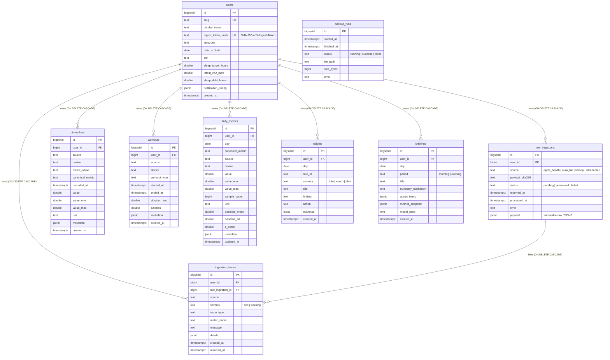

# ARCHITECTURE.md — Prana Modular Architecture

## 1. Design Constraints
- **Target Host:** Raspberry Pi 4 (ARM64, Docker Engine + Compose).
- **100% Containerized:** Zero bare-metal app/cron dependencies on the host OS.
- **Multi-User:** Household-ready from Day 1 (`user_id` scoping + per-user `X-Ingest-Token`).
- **No Oura Subscription:** Oura Ring 4 data is extracted locally over BLE (no Oura Cloud API v2).
- **No iOS Developer Account:** Apple Watch Series 8 data is pushed via the App Store app **Health Auto Export**.
- **Port Series:** `9xxx` (`9000` for ingestor API, `9300` for Grafana) to avoid `8xxx` collisions (e.g., Home Assistant).
- **Local-First Edge:** Runs on LAN (`http://<PI_IP>:9000`) and can be exposed over HTTPS via `cloudflared` tunnel when a custom domain is attached.

---

## 2. Container Topology

| Service | Image | Purpose |
| :--- | :--- | :--- |
| `db` | `postgres:18.7-alpine` | Primary multi-user PostgreSQL 18 database (`pgdata` volume) |
| `prana` | `./app` (`python:3.12-slim-bookworm`, UID 1000) | FastAPI ingestor & analyzer (`:9000`), Alembic auto-migrations, APScheduler (nightly `pg_dump -Fc` backups, twice-daily analysis & briefings) |
| `oura-ble` | `./oura-ble` (Profile `oura`) | Local BLE sync (`Th0rgal/open_oura`) via host D-Bus (`/var/run/dbus`), presence-triggered with a 1h successful-sync cooldown to `prana` |
| `cloudflared` | Profile `tunnel` | Cloudflare Tunnel (`https://ingest.<domain>` → `http://prana:9000`) |
| `grafana` | `grafana/grafana-oss:11.5.2` (Profile `dashboard`, `:9300`) | Read-only SQL dashboards (`prana_ro` role) visualizing daily metrics, separate wearable series, cross-wearable deltas, insights, and briefings |

---

## 3. Modular Layer & Contract Boundaries

### Module 1: Source Connectors (External / Plug-and-Play)
- **Apple Watch 8:** `Health Auto Export` (iOS) → `POST /api/v1/ingest/apple-health`
- **Oura Ring 4:** `open_oura` (`oura-ble/sync.py`, Pi 4 BLE via host D-Bus) → `POST /api/v1/ingest/oura`. Polls for ring BLE presence every `OURA_POLL_INTERVAL_SEC` (default `30s`) with `OURA_SCAN_TIMEOUT_SEC` (`10s`), triggers `oura sync` only when RSSI ≥ `OURA_MIN_RSSI_DBM` (`-80 dBm`) and elapsed time since `/data/last_sync_unix.txt` exceeds `OURA_SYNC_INTERVAL_SEC` (`3600s`), and updates `/data/last_sync_unix.txt` only after both `oura sync` and all `/api/v1/ingest/oura` batches succeed.
- **Future (Whoop / Ultrahuman):** Standalone puller scripts → `POST /api/v1/ingest/points`

### Module 2: Ingestion & Normalization Gateway (`app/prana/ingestor/`)
- Authenticates `X-Ingest-Token` against SHA-256 hashed tokens in `users` using a single pooled connection per request (`psycopg_pool`).
- Persists raw payload first to `raw_ingestions` (`JSONB`, deduplicated by `payload_sha256`).
- Bulk-upserts normalized records into `biomarkers` and `workouts` using `UNIQUE(user_id, source, device, metric_name, recorded_at)` and `UNIQUE(user_id, source, device, workout_type, started_at)`, mapping known metrics to `canonical_metric`.
- Records contract drift (`warning`) and parse/persistence failures (`sos`) in `ingestion_issues`, surfaced via `GET /api/v1/status` and reprocessable via `POST /api/v1/admin/reprocess`.

### Module 3: Storage Layer (`app/prana/models.py` + `app/alembic/`)
- `users`: `id`, `slug`, `display_name`, `ingest_token_hash`, `timezone`, `date_of_birth`, `sex`, `sleep_target_hours`, `latest_vo2_max`, `sleep_debt_hours`, `notification_config` (`JSONB`).
- `raw_ingestions`: Immutable `JSONB` archive per `user_id` and `source` with `payload_sha256`, `status`, `processed_at`, `error`.
- `biomarkers`: Normalized time-series (`user_id`, `source`, `device`, `metric_name`, `canonical_metric`, `recorded_at`, `value`, `value_min`, `value_max`, `unit`, `metadata`).
- `workouts`: Normalized workout sessions (`user_id`, `source`, `device`, `workout_type`, `started_at`, `ended_at`, `duration_sec`, `calories`, `metadata`).
- `ingestion_issues`: Durable `sos` and `warning` contract/parse issue log linked to `raw_ingestions`.
- `backup_runs`: Audit log of nightly `pg_dump -Fc` runs (`status`, `file_path`, `size_bytes`, `error`).
- `daily_metrics`: Per-user daily aggregated biomarkers (`sleep_duration` kept separate per `(source, device)`, `sleep_debt`, `hrv_ln`, `workout_load`, `acwr`, etc.) with 60-day rolling `baseline_mean`, `baseline_sd`, and `z_score` (unrecorded days excluded rather than zero-filled).
- `insights`: Evidence-based physiological findings and actions produced by Rules A–H per `user_id` and `day`.
- `briefings`: Stored morning (`08:00`) and evening (`22:00`) biomarker briefings per `user_id`, `day`, and `period` with JSON snapshot provenance.

#### Entity-Relationship Schema

#### Constraints & Indexes
- **Idempotency Keys:**
  - `raw_ingestions`: `UNIQUE (user_id, source, payload_sha256)` — exact re-sends are skipped cleanly.
  - `biomarkers`: `UNIQUE (user_id, source, device, metric_name, recorded_at)` — safe upserts per device on overlapping Health Auto Export / BLE syncs.
  - `workouts`: `UNIQUE (user_id, source, device, workout_type, started_at)` — safe upserts per device on workout re-syncs.
  - `daily_metrics`: `UNIQUE (user_id, day, canonical_metric, source, device)` — separates Apple Watch vs Oura metrics while guaranteeing idempotent rollups.
  - `insights`: `UNIQUE (user_id, day, rule_id)` — idempotent daily rule evaluation.
  - `briefings`: `UNIQUE (user_id, day, period)` — idempotent morning/evening briefings.
- **Query Indexes:**
  - `idx_raw_ingestions_user_source_time (user_id, source, received_at DESC)`
  - `idx_raw_ingestions_status (status, received_at DESC)`
  - `idx_biomarkers_user_metric_time (user_id, metric_name, recorded_at DESC)`
  - `idx_biomarkers_user_canonical_time (user_id, canonical_metric, recorded_at DESC)`
  - `idx_biomarkers_user_source_time (user_id, source, recorded_at DESC)`
  - `idx_workouts_user_time (user_id, started_at DESC)`
  - `idx_backup_runs_started (started_at DESC)`
  - `idx_daily_metrics_user_metric_day (user_id, canonical_metric, day DESC)`
  - `idx_insights_user_day (user_id, day DESC)`
  - `idx_briefings_user_day (user_id, day DESC, period)`

### Module 4: Maintenance & Backups (`app/prana/maintenance/`)
- Scheduled inside `prana` via APScheduler (`03:00` local time by default, with `coalesce=True` and 6h `misfire_grace_time`; requires single uvicorn worker).
- Streams `pg_dump -Fc` (matching PostgreSQL 18 client) atomically to `/backups/prana_<stamp>.dump` with `0600` permissions and `BACKUP_RETENTION_DAYS` pruning, recording each run in `backup_runs`. Includes `restore` CLI via `pg_restore`.

### Module 5: Logging Infrastructure (`app/prana/logging_setup.py`)
- Every module logs structured JSON (`timestamp`, `level`, `logger`, `message`, plus contextual fields) to `stdout`.
- `docker-compose.yml` enforces `json-file` log rotation (`max-size: 10m`, `max-file: 5`) on all containers.

### Module 6: Analysis, Briefings & Visualizations (`app/prana/analyzer/`, `grafana/`)
- Ingestion endpoints (`/api/v1/ingest/*`) automatically refresh recent `daily_metrics` (14d window) and `insights` so dashboard metrics stay current on every wearable sync, without triggering AI calls on every sync. Scheduled AI analysis runs twice daily via APScheduler (`MORNING_BRIEFING_HOUR=8`, `EVENING_BRIEFING_HOUR=22` in the server's configured `TZ`, while per-user date attribution uses `users.timezone`) and on-demand via `POST /api/v1/analysis/run`:
  1. **Daily Rollup (`rollup.py`):** De-duplicates overlapping sleep stage segments (removing overarching `InBed` containers wrapping child stages), assigns overnight sleep via `+6h` wake-date attribution while keeping Apple Watch and Oura separate, aggregates daily metrics, computes 60-day rolling baselines/z-scores, ACWR, and 14-day sleep debt strictly skipping missing days/nights. Updates `users.latest_vo2_max` and `users.sleep_debt_hours`.
  2. **Evidence-Based Rules (`rules.py`):** Evaluates Rules A–H per `user_id` (`recovery_autonomic`, `illness_early_warning`, `cardiorespiratory_vo2max`, `sleep_debt_tracker`, `training_load_acwr`, `sedentary_activity`, `personal_correlations`, `cross_device_sleep_gap`).
  3. **Twice-Daily Briefings (`briefing.py`):** Synthesizes morning (sleep + readiness guidance; if overnight sleep has not synced at `08:00`, stores a deterministic placeholder and invokes Gemini once that day's sleep arrives) and evening (day-so-far + tonight's sleep target at `22:00`, with post-`22:00` recovery if an evening slot fell back to deterministic) briefings via Gemini REST API when `GEMINI_API_KEY` is configured, retrying transient `408/429/5xx` & network errors with backoff before falling back to a deterministic template (and never downgrading an existing AI briefing to deterministic). Stored in `briefings` and displayed alongside trends in Grafana (`:9300`, `prana_ro`) using local `generated_at` timestamps.
  4. **Cross-Wearable Dashboard (`grafana/dashboards/prana_daily_health.json`):** Plots Apple Watch and Oura Ring separately on overlapping metrics (Sleep Duration, HRV SDNN vs RMSSD, Resting Heart Rate, Respiratory Rate, Mean Heart Rate, and Skin/Wrist Temperature) plus a dedicated **Oura vs Apple Watch** delta timeseries (`Oura − Apple Watch` on days with both devices present) and a daily cross-wearable concordance table.

---

## 4. HTTP API Endpoints

| Method | Path | Auth | Purpose |
| :--- | :--- | :--- | :--- |
| `GET` | `/health` | None | Lightweight liveness check (`200` if DB reachable, `503` otherwise) |
| `GET` | `/api/v1/status` | None (`X-Admin-Token` optional for `?detail=1`) | Aggregate health (`ok \| degraded \| critical`) across DB, migrations, SOS/warnings, backups, and scheduler |
| `GET` | `/api/v1/stats` | `X-Ingest-Token` | Per-user biomarker, workout, and raw ingestion counts (`?source=` filter optional) |
| `POST` | `/api/v1/users` | `X-Admin-Token` | Create or update a household user and their profile/ingest token |
| `POST` | `/api/v1/ingest/apple-health` | `X-Ingest-Token` | Raw-first ingestion and normalization for Health Auto Export JSON payloads |
| `POST` | `/api/v1/ingest/oura` | `X-Ingest-Token` | Raw-first ingestion and normalization for `open_oura` BLE event payloads |
| `POST` | `/api/v1/ingest/points` | `X-Ingest-Token` | Generic normalized point ingestion for standalone source connectors |
| `POST` | `/api/v1/admin/reprocess` | `X-Admin-Token` | Re-run normalization on stored `raw_ingestions` (`apple_health` / `oura_ble`) |
| `POST` | `/api/v1/analysis/run` | `X-Ingest-Token` | Compute daily rollups, evaluate physiological rules A-H, and generate morning/evening briefings |
| `GET` | `/api/v1/insights` | `X-Ingest-Token` | Return per-user profile rollups (`latest_vo2_max`, `sleep_debt_hours`), active insights, and recent briefings |
