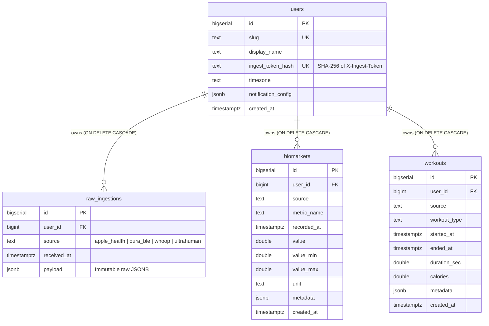

# ARCHITECTURE.md — Prana Modular Architecture

## 1. Design Constraints
- **Target Host:** Raspberry Pi 4 (ARM64, Docker Engine + Compose).
- **100% Containerized:** Zero bare-metal app/cron dependencies on the host OS.
- **Multi-User:** Household-ready from Day 1 (`user_id` scoping + per-user `X-Ingest-Token`).
- **No Oura Subscription:** Oura Ring 4 data is extracted locally over BLE (no Oura Cloud API v2).
- **No iOS Developer Account:** Apple Watch Series 8 data is pushed via the App Store app **Health Auto Export**.
- **Port Series:** `9xxx` (`9000` for ingestor API, `9300` for Grafana in Phase 4) to avoid `8xxx` collisions (e.g., Home Assistant).
- **Local-First Edge:** Starts on LAN (`http://<PI_IP>:9000`), later exposed via `cloudflared` tunnel when a custom domain is attached.

---

## 2. Container Topology (Optimized 2-Core-Container Design)

| Service | Image | Purpose | Phase |
| :--- | :--- | :--- | :--- |
| `db` | `postgres:18.7-alpine` | Primary multi-user PostgreSQL 18 database (`pgdata` volume) | 1A |
| `prana` | `./app` (`python:3.12-slim-bookworm`, UID 1000) | FastAPI ingestor (`:9000`), Alembic auto-migrations, APScheduler (nightly `pg_dump -Fc` backups; later AI analyzer & notifier) | 1A |
| `oura-ble` | Profile `oura` | Local BLE sync (`Th0rgal/open_oura` or `LogosIsLife/open_ring`) via host D-Bus, pushing to `prana` | 1B |
| `cloudflared` | Profile `tunnel` | Cloudflare Tunnel (`https://ingest.<domain>` → `http://prana:9000`) | 2 |
| `grafana` | Profile `dashboard` (`:9300`) | Read-only SQL dashboards | 4 |

---

## 3. Modular Layer & Contract Boundaries

### Module 1: Source Connectors (External / Plug-and-Play)
- **Apple Watch 8:** `Health Auto Export` (iOS) → `POST /api/v1/ingest/apple-health`
- **Oura Ring 4:** `open_oura` / `open_ring` (Pi 4 BLE) → `POST /api/v1/ingest/points`
- **Future (Whoop / Ultrahuman):** Standalone puller scripts → `POST /api/v1/ingest/points`

### Module 2: Ingestion & Normalization Gateway (`app/prana/ingestor/`)
- Authenticates `X-Ingest-Token` against SHA-256 hashed tokens in `users` using a single pooled connection per request (`psycopg_pool`).
- Persists raw payload first to `raw_ingestions` (`JSONB`, deduplicated by `payload_sha256`).
- Bulk-upserts normalized records into `biomarkers` and `workouts` using `UNIQUE(user_id, source, device, metric_name, recorded_at)` and `UNIQUE(user_id, source, device, workout_type, started_at)`, mapping known metrics to `canonical_metric`.
- Records contract drift (`warning`) and parse/persistence failures (`sos`) in `ingestion_issues`, surfaced via `GET /api/v1/status` and reprocessable via `POST /api/v1/admin/reprocess`.

### Module 3: Storage Layer (`app/prana/models.py` + `app/alembic/`)
- `users`: `id`, `slug`, `display_name`, `ingest_token_hash`, `timezone`, `notification_config` (`JSONB`).
- `raw_ingestions`: Immutable `JSONB` archive per `user_id` and `source` with `payload_sha256`, `status`, `processed_at`, `error`.
- `biomarkers`: Normalized time-series (`user_id`, `source`, `device`, `metric_name`, `canonical_metric`, `recorded_at`, `value`, `value_min`, `value_max`, `unit`, `metadata`).
- `workouts`: Normalized workout sessions (`user_id`, `source`, `device`, `workout_type`, `started_at`, `ended_at`, `duration_sec`, `calories`, `metadata`).
- `ingestion_issues`: Durable `sos` and `warning` contract/parse issue log linked to `raw_ingestions`.
- `backup_runs`: Audit log of nightly `pg_dump -Fc` runs (`status`, `file_path`, `size_bytes`, `error`).

#### Entity-Relationship Schema

#### Constraints & Indexes
- **Idempotency Keys:**
  - `raw_ingestions`: `UNIQUE (user_id, source, payload_sha256)` — exact re-sends are skipped cleanly.
  - `biomarkers`: `UNIQUE (user_id, source, device, metric_name, recorded_at)` — safe upserts per device on overlapping Health Auto Export / BLE syncs.
  - `workouts`: `UNIQUE (user_id, source, device, workout_type, started_at)` — safe upserts per device on workout re-syncs.
- **Query Indexes:**
  - `idx_raw_ingestions_user_source_time (user_id, source, received_at DESC)`
  - `idx_biomarkers_user_metric_time (user_id, metric_name, recorded_at DESC)`
  - `idx_biomarkers_user_source_time (user_id, source, recorded_at DESC)`
  - `idx_workouts_user_time (user_id, started_at DESC)`

### Module 4: Maintenance & Backups (`app/prana/maintenance/`)
- Scheduled inside `prana` via APScheduler (`03:00` local time by default, with `coalesce=True` and 6h `misfire_grace_time`; requires single uvicorn worker).
- Streams `pg_dump -Fc` (matching PostgreSQL 18 client) atomically to `/backups/prana_<stamp>.dump` with `0600` permissions and `BACKUP_RETENTION_DAYS` pruning, recording each run in `backup_runs`. Includes `restore` CLI via `pg_restore`.

### Module 5: Logging Infrastructure (`app/prana/logging_setup.py`)
- Every module logs structured JSON (`timestamp`, `level`, `logger`, `message`, plus contextual fields) to `stdout`.
- `docker-compose.yml` enforces `json-file` log rotation (`max-size: 10m`, `max-file: 5`) on all containers.

### Module 6: Analysis, AI & Notifications *(Phase 3)*
- Runs as a scheduled job inside `prana`:
  1. Deterministic stats per `user_id` (7d vs 30d baselines, z-scores, cross-device divergence, lag correlations).
  2. Off-the-shelf LLM synthesis on detected anomalies.
  3. **Apprise** notification dispatch using each user's `notification_config`.
